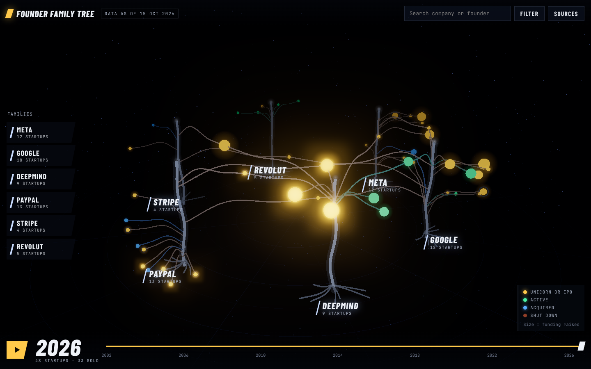

# Founder Family Tree

An interactive 3D tree of startups founded by former employees of **Google, PayPal, Stripe, Meta, DeepMind and Revolut**. Each big company is a glowing trunk, and branches grow out to the startups its alumni went on to found. Every founder-to-company link has a public source.

**Try it:** https://arikhanacademic-cpu.github.io/founder-family-tree/

Data as of **15 October 2026**. 48 startups, 78 founders, 96 unique source URLs.



## What you can do

- **Watch it grow.** A time-lapse from 2002 to 2026. Branches sprout in the year each startup was founded. Unicorns and IPOs bloom gold, and shut-down startups fall away as embers.
- **Mafia mode.** Pick a family, such as the PayPal Mafia, and the camera flies to that trunk. A counter adds up the combined value of its startups, using publicly reported figures only.
- **Search** for any company or founder, then **click a leaf** to see its founders, founding year, status, funding, valuation and sources.
- **Filter** by sector (AI, fintech, devtools and more) or by country. You can also switch leaf size between *funding raised* and *valuation / exit*.
- **Cross-company branches.** When co-founders came from different parents (Mistral AI from Meta and DeepMind, OpenAI from Stripe and Google), the leaf hangs between those trunks.
- **Deep links.** `#paypal`, `#google`, `#meta`, `#deepmind`, `#stripe` and `#revolut` open straight into that family.

## Colour key

| Colour | Meaning |
|---|---|
| Gold | Unicorn ($1B+ sourced valuation or exit) or IPO |
| Green | Active |
| Blue | Acquired (a blue ring on a gold leaf means an acquired unicorn) |
| Faint ember | Shut down |

## Data and method

All data lives in [`js/data.js`](js/data.js). Each startup has its founders, the parent company each one worked at, the founder's role there, and a **source URL for every link**.

- **Founder links.** A founder is listed only when a public page says they worked at the parent company before founding the startup. Acceptable pages are a company site, the founder's own bio, or reputable press. Wikipedia is used only where nothing better could be reached. No link is inferred, and internships were dropped.
- **Value.** This is the latest publicly reported valuation, exit price or market cap, and its date is shown in the label. Market caps are as of October 2026. Currency conversions are labelled as estimates.
- **Funding.** This is total funding where a source states it. "Sum of announced rounds" means we added up the publicly announced rounds ourselves. Where no reliable public total exists, the field is left blank, and the leaf is drawn small and dim.
- **Combined value (mafia mode).** This is the sum of the figures above. The dates differ and the numbers are not inflation-adjusted. When one startup was absorbed by another startup in the same view, it is counted only once (xAI and Twitter/X inside SpaceX, Statsig inside OpenAI). The total measures company value. It does not estimate founder wealth.
- **Gold timing.** A leaf turns gold in its IPO year, or in the year of the sourced $1B+ figure. That year can be later than the company's first $1B round.
- **Known gaps.** This is a curated sample, not a census. The Stripe and Revolut lists are short because fewer links could be verified. For some smaller startups, the status was last confirmed before October 2026, and their cards give that date.

Spotted an error, or have a source for a missing link? Open an issue with the URL.

## Run locally

It is a static site with no build step.

```bash
python3 -m http.server 8000
# open http://localhost:8000
```

## Deploy to GitHub Pages

1. Push this folder to a new repository named `founder-family-tree`.
2. Go to **Settings → Pages → Build and deployment**, choose **Deploy from a branch**, then select `main` and `/ (root)`.
3. The site goes live at `https://<you>.github.io/founder-family-tree/`.

## Tech

- [three.js](https://threejs.org) r160 (vendored in `vendor/three`, MIT): scene, `UnrealBloomPass` bloom, exponential fog and `CSS2DRenderer` labels.
- Barlow Condensed and JetBrains Mono, self-hosted in `fonts/` (SIL Open Font License).
- Plain ES modules, with no framework and no build.

## Notes

The site uses company names as text only, with no logos. It is not affiliated with or endorsed by any company it names. All figures are publicly reported and dated. Nothing here is investment advice.

Built by **Ari Khan**.

## License

The code is MIT licensed (see `LICENSE`). Data compilation © 2026 Ari Khan, CC BY 4.0. The cited sources belong to their publishers.
